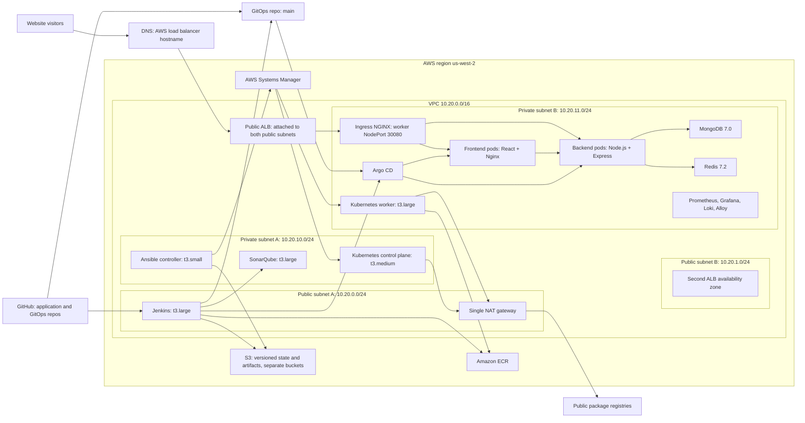
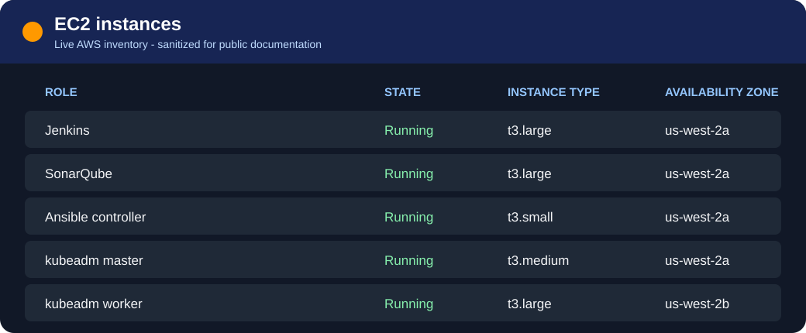

# AWS and Kubernetes map

This page is the map of the deployed system. The AWS region is `us-west-2`. The VPC has four
subnets across two Availability Zones (separate AWS data-center areas).

## Architecture diagram

The drawing is a guide, not a scale map. The ALB is attached to both public subnets. Jenkins and
the single NAT gateway are in public subnet A. SonarQube, Ansible, and the Kubernetes control
plane are in private subnet A. The Kubernetes worker is in private subnet B; the application and
monitoring pods run on that one worker.

## Component breakdown

| Component | What it does |
|---|---|
| Application Load Balancer (ALB) | Receives website traffic and forwards it to the worker's application NodePort |
| Ingress NGINX | Routes a request to the website or API inside Kubernetes |
| Frontend | React website served by an unprivileged Nginx container |
| Backend | Node.js and Express API |
| MongoDB and Redis | Store application data and provide the configured cache/session service |
| Jenkins | Runs code checks, builds and scans images, pushes approved images to ECR |
| SonarQube | Analyzes source code and returns the quality-gate result to Jenkins |
| Argo CD | Reads the GitOps repository and reconciles Kubernetes with its declared settings |
| Ansible | Installs and configures services on the EC2 instances through SSM |
| Prometheus, Grafana, Loki, and Alloy | Collect metrics, show dashboards, and ship logs into the log store |
| Terraform | Describes the AWS network, instances, IAM, registry, and storage resources |
| Amazon ECR and S3 | Store container images, infrastructure state, and CI artifacts in separate resources |

## Subnets and important AWS resources

| Network area | CIDR block | Main purpose |
|---|---|---|
| VPC | `10.20.0.0/16` | Private address space for the project |
| Public subnet A | `10.20.0.0/24` | Jenkins and the NAT gateway |
| Public subnet B | `10.20.1.0/24` | Second Availability Zone used by the ALB |
| Private subnet A | `10.20.10.0/24` | SonarQube, Ansible, and the Kubernetes control plane |
| Private subnet B | `10.20.11.0/24` | Kubernetes worker, application pods, and monitoring |

The internet gateway connects the public route table to the internet. Private subnets use one NAT
gateway for outbound downloads and updates; they do not have direct inbound internet routes. An
S3 gateway endpoint lets the VPC reach S3 without sending that traffic through the NAT gateway.
The NAT gateway is a single point of failure and can continue to incur charges while the lab is
running.

## What happens to a web request?

1. A visitor opens the website using the ALB hostname (or the configured custom domain).
2. The public ALB forwards traffic to the Kubernetes worker's NodePort `30080`.
3. Ingress NGINX chooses the frontend or backend service.
4. The backend talks to MongoDB and Redis inside the cluster.
5. The security groups allow the ALB to reach the worker's application NodePort, not every server.

The default configuration leaves `domain_name` empty, so the site uses the ALB DNS hostname over
HTTP. A custom domain can add a Route 53 alias and an ACM certificate for HTTPS. Do not assume
HTTPS is active unless the domain and certificate have been configured and the ALB listener has
been verified.

## Network and security boundaries

| Connection | Intended access |
|---|---|
| Public internet to ALB | Web traffic on ports 80 and 443; an HTTPS listener depends on domain/certificate configuration |
| ALB to Kubernetes worker | Application NodePort `30080` only |
| Jenkins to SonarQube | SonarQube web/API port `9000` |
| Jenkins to Argo CD | Argo CD NodePort `32080` for release verification |
| Operator to EC2 administration | AWS Systems Manager Session Manager; SSH/port 22 is not opened |
| Public internet to Jenkins | Restricted by the configured allowlist; the actual allowed addresses are intentionally not published |
| Public internet to Grafana, SonarQube, or Argo CD | No direct public admin route is intended |

Jenkins is in a public subnet, but its inbound access is restricted. SonarQube and Argo CD accept
administrative traffic from Jenkins rather than from arbitrary internet hosts. Grafana is a
cluster-internal service.

EC2 instance profiles provide the machine permissions used by the deployment. Depending on the
role, these include Systems Manager registration and command/session access, CloudWatch agent
publishing, scoped reads of encrypted Parameter Store values, S3 artifact access, and ECR image
push or pull. Human operators still need an AWS identity with the appropriate SSM and project
permissions; an instance role is not a substitute for operator authorization.

SSH port 22 is not opened. AWS Systems Manager (SSM) Session Manager is the supported path for
administrative sessions and port forwarding. The EKS Terraform module is parked for a future
phase; this deployment uses a kubeadm cluster, not EKS.

## AWS instance inventory

This readable inventory view is based on the live AWS EC2 inventory at capture time. It omits
account numbers, instance IDs, DNS names, and IP addresses.

The inventory is a snapshot: instances may be stopped, replaced, or resized later. The AWS console
is not exposed in this public guide.
