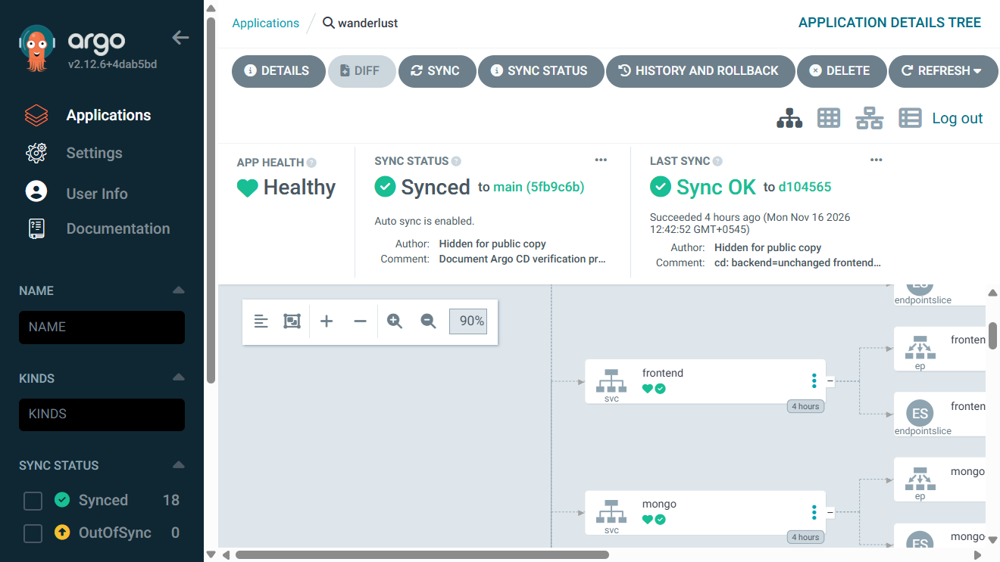

# Release and GitOps

The delivery pipeline does not send an image straight to a running server. It records the
approved image version in Git, and Argo CD applies that version to Kubernetes.

## The release path

1. Jenkins finishes the application checks and publishes an image to Amazon ECR.
2. The GitOps job updates only the changed service's image tag.
3. Argo CD notices the Git change and applies the Helm chart to Kubernetes.
4. Jenkins checks Argo CD for **Synced** and **Healthy** status.

If only the frontend changed, the backend image tag stays as it was, and vice versa.

## What Argo CD reports

- **Synced** means the resources in Kubernetes match the version described in Git.
- **Healthy** means Argo CD considers the application's resources healthy.
- **Sync OK** means the last sync completed successfully.

The application is configured for automatic sync, pruning, and self-healing. Pruning removes
managed resources that were deleted from Git; self-healing returns manually changed resources to
the Git-defined settings.

{.document-screenshot-link target=_blank rel=noopener}

*Argo CD's application view. Operator details were removed from this public copy; the resource tree can be wider than the screen. Select the image to see the complete captured screen.*

The tree view shows how Kubernetes resources relate to one another. The list view gives a more
compact status check:

{.document-screenshot-link target=_blank rel=noopener}

*The resource list includes the application health and sync summary. Private addresses and operator identity were removed from this public copy.*

## Why the Git record matters

If someone changes a deployment directly in Kubernetes, the cluster and Git no longer describe the
same desired state. Keeping the image version in Git makes a release reviewable and gives the team
a clear starting point for a rollback.

If Argo CD does not become Synced and Healthy within the delivery job's wait period, the job fails
so an operator can inspect the sync status, application events, and Kubernetes pods.
