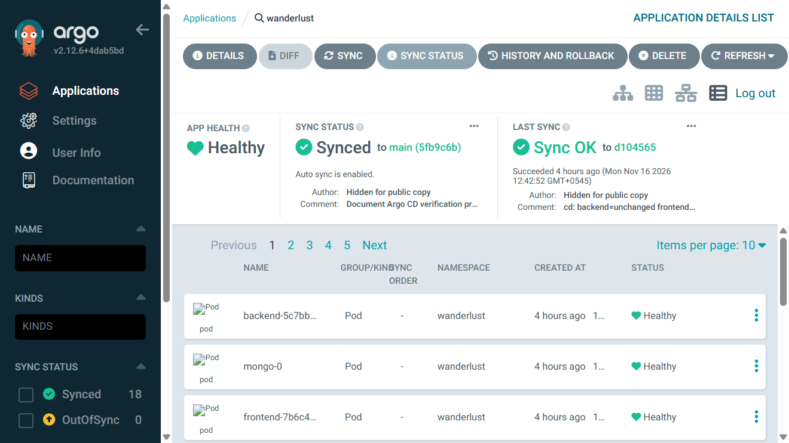

# Release and GitOps

The delivery pipeline does not send an image straight to a running server. It records the
approved image version in Git, and Argo CD applies that version to Kubernetes.

## The release path

1. Jenkins finishes the application checks and publishes an image to Amazon ECR.
2. The GitOps job updates only the changed service's image tag.
3. Argo CD notices the Git change and applies the Helm chart to Kubernetes.
4. Jenkins checks Argo CD for **Synced** and **Healthy** status.

If only the frontend changed, the backend image tag stays as it was, and vice versa.

## What Argo CD reports

- **Synced** means the resources in Kubernetes match the version described in Git.
- **Healthy** means Argo CD considers the application's resources healthy.
- **Sync OK** means the last sync completed successfully.

The application is configured for automatic sync, pruning, and self-healing. Pruning removes
managed resources that were deleted from Git; self-healing returns manually changed resources to
the Git-defined settings.

## Deployment strategy

The application uses Kubernetes `RollingUpdate` deployments. Each service currently has one
replica, with `maxUnavailable: 0` and `maxSurge: 1`: Kubernetes keeps the existing pod while it
tries to bring up the new one, then replaces it after the new pod is ready. This is a rolling
update, not a blue/green or canary release. A PodDisruptionBudget is not enabled, and both
application services share one worker, so this is not a high-availability guarantee.

{.document-screenshot-link target=_blank rel=noopener}

*Argo CD's application view. Operator details were removed from this public copy; the resource tree can be wider than the screen. Select the image to see the complete captured screen.*

The tree view shows how Kubernetes resources relate to one another. The list view gives a more
compact status check:

{.document-screenshot-link target=_blank rel=noopener}

*The resource list includes the application health and sync summary. Private addresses and operator identity were removed from this public copy.*

## Why the Git record matters

If someone changes a deployment directly in Kubernetes, the cluster and Git no longer describe the
same desired state. Keeping the image version in Git makes a release reviewable and gives the team
a clear starting point for a rollback.

If Argo CD does not become Synced and Healthy within the delivery job's wait period, the job fails
so an operator can inspect the sync status, application events, and Kubernetes pods.

The `Verify ArgoCD sync` stage runs only when both `VERIFY_ARGOCD=true` and `ARGOCD_URL` are set in
the Jenkins job environment. The Ansible-managed Jenkins configuration sets both values for this
project. The stage also needs a valid `argocd-token` credential. If Jenkins marks this stage as
skipped, check that the latest Jenkins configuration was applied and that the URL and credential
are present; a skipped stage does not prove that the deployment is healthy.

## Roll back an application release

The GitOps repository is the source of truth. Do not roll back by changing a running pod with
`kubectl`; Argo CD will reconcile it back to the version in Git.

1. Find the last known-good image tag in the Jenkins history or the GitOps commit history.
2. In `wanderlust-gitops`, restore only the failed service's image tag in
   `helm/wanderlust/values-prod.yaml` to that known-good tag. Keep the other service's tag
   unchanged.
3. Review the diff, commit the rollback to `main`, and push it.
4. Wait for Argo CD to report **Synced** and **Healthy** and for the replacement pod to become
   Ready. Confirm the website and API health check.

If the failed release is the latest GitOps commit and contains only the intended tag update, an
authorized operator can use `git revert <release-commit>` instead of editing the tag manually.
Do not force-push or rewrite the shared `main` branch.

For an infrastructure change, restore the Terraform configuration in Git, create and review a
new Terraform plan, then apply it only with approval. Do not manually edit or restore the remote
state file as a shortcut.
