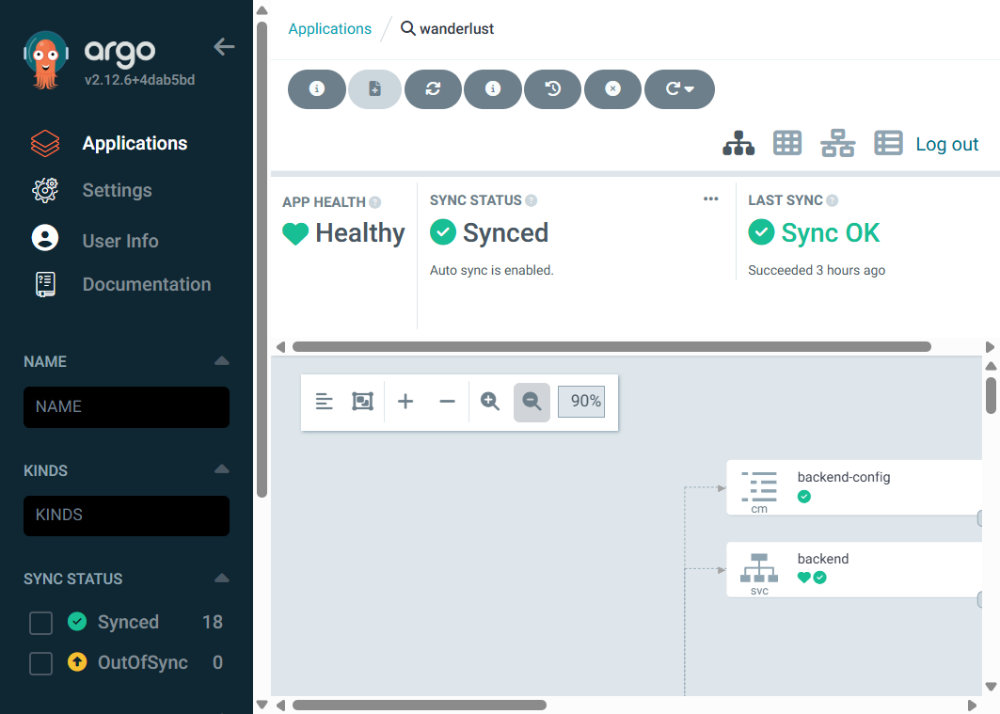

# GitOps and Argo CD: deploy from Git

CD means **continuous delivery**. This project uses GitOps: instead of asking someone to click
“deploy” for every release, the desired application version is written in Git and Argo CD keeps
Kubernetes aligned with it.

## The release path

```text
App code change
  -> Jenkins CI tests and scans it
  -> Docker image is pushed to ECR with a version tag
  -> Jenkins CD updates only that image tag in GitOps
  -> Argo CD notices the Git change
  -> Argo CD applies the Helm chart to Kubernetes
  -> Jenkins can verify Synced and Healthy
```

The GitOps pipeline checks the supplied tags before changing the chart values. If only the
frontend changed, it leaves the backend tag alone (and vice versa). It commits and pushes the
change to the GitOps repository.

## Argo CD's job

Argo CD watches the configured GitOps branch and Helm chart. Automated sync is enabled, with
pruning and self-healing:

- **Sync** applies a change from Git to the cluster.
- **Prune** removes a managed object that was removed from Git.
- **Self-heal** brings a manually changed cluster object back to its Git-defined setting.

The Argo CD application is private. Jenkins can reach the Argo CD API from inside the AWS network;
the application is not exposed as a public admin website.



*The screenshot is sanitized to remove user identity and internal service addresses. Green
“Healthy” and “Synced” states are the desired result.*

## Verification is part of delivery

After pushing the GitOps update, the CD job can poll Argo CD until the application reports
`Synced` and `Healthy`. If that does not happen within the wait window, the CD job fails so an
operator can inspect Argo CD and the Kubernetes pods.

The wait matters because GitOps is asynchronous: Argo CD needs a little time to notice a new
commit and reconcile the cluster.

## Why not deploy by hand?

If someone changes a deployment directly in Kubernetes, Git would no longer describe what is
running. GitOps makes the desired version reviewable, repeatable, and easier to roll back.
