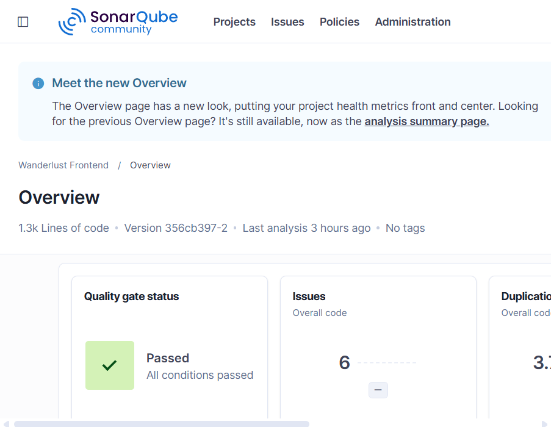

# Jenkins: how a change is checked

The frontend and backend each have a Jenkins pipeline. A pipeline is a repeatable checklist: it
runs the same tests and scans for every change, rather than relying on someone to remember each
step.

{.document-screenshot-link target=_blank rel=noopener}

*A full-screen capture scrolled to show the three job rows together. Select the image to open it at original size.*

The dashboard keeps the last successful and failed build for each job. An older failure can remain
visible after a later success; it is retained as history, not an indication that the latest build
failed. The image is a snapshot, so its build numbers and times will change.

## What each application pipeline does

1. Checks out the source and creates a build version from the commit and Jenkins build number.
2. Scans for committed secrets with Gitleaks.
3. Checks source code and dependencies with Trivy and OWASP Dependency-Check.
4. Runs the Jest test suite.
5. Sends the code to SonarQube and waits for the configured quality gate.
6. Checks container and configuration files with Hadolint and Trivy.
7. Builds the container image and scans it with Trivy.
8. Publishes the image to the private Amazon ECR registry.
9. Starts the GitOps delivery job with the new image version.

A failed check stops the pipeline. The failed stage is the place to start investigating; repeatedly
rerunning the whole job usually does not help until the cause is fixed.

## SonarQube quality gate

Jenkins waits for SonarQube's result before it publishes an image. If the quality gate fails, the
pipeline stops at that point.

{.document-screenshot-link target=_blank rel=noopener}

*The captured project overview shows the quality gate as “Passed.” This is the complete visible screen from that session; select the image for the original-size version.*

The gate applies the project's configured conditions to the analysis. A pass records the result
for that analysis only; it is not a guarantee about a later commit.

## Tracing an image back to its source

Image tags contain a short commit ID and Jenkins build number, such as
`<short-commit>-<build-number>`. That makes it possible to connect a deployed image to the source
change and the pipeline run that built it.

AWS access to ECR comes from the instance role. Other sensitive values are kept in SSM or Jenkins
credentials; they are not placed in image tags.
