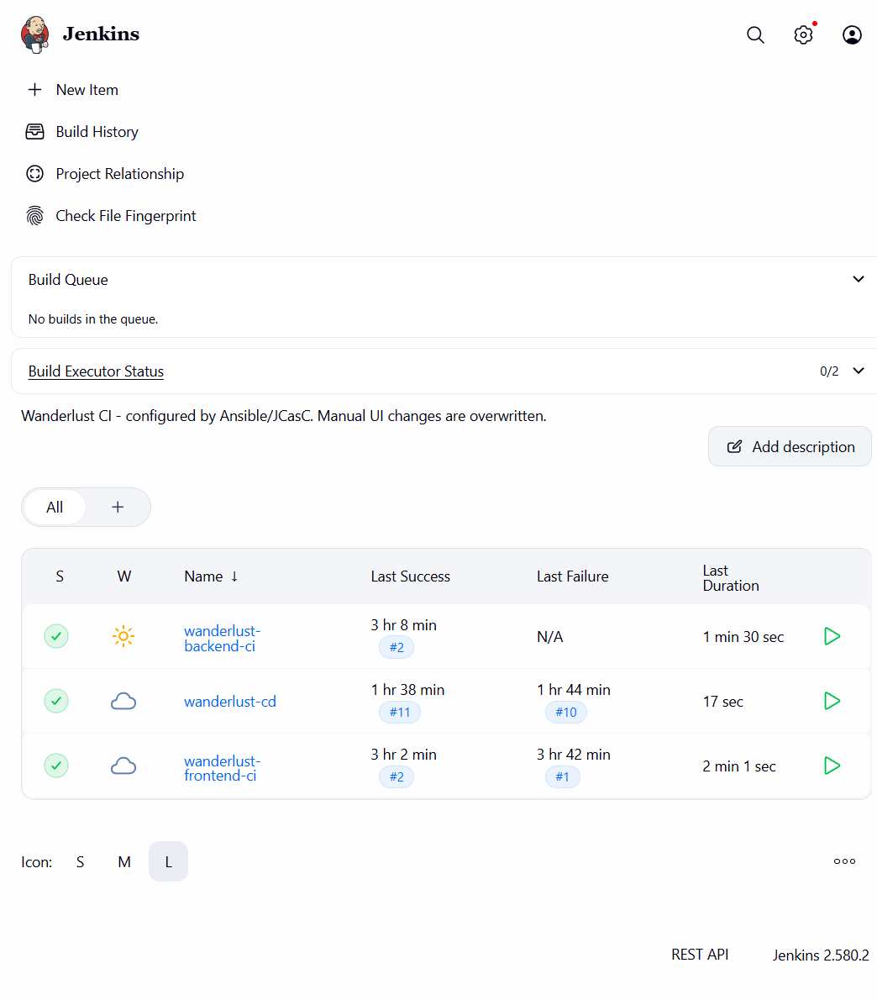
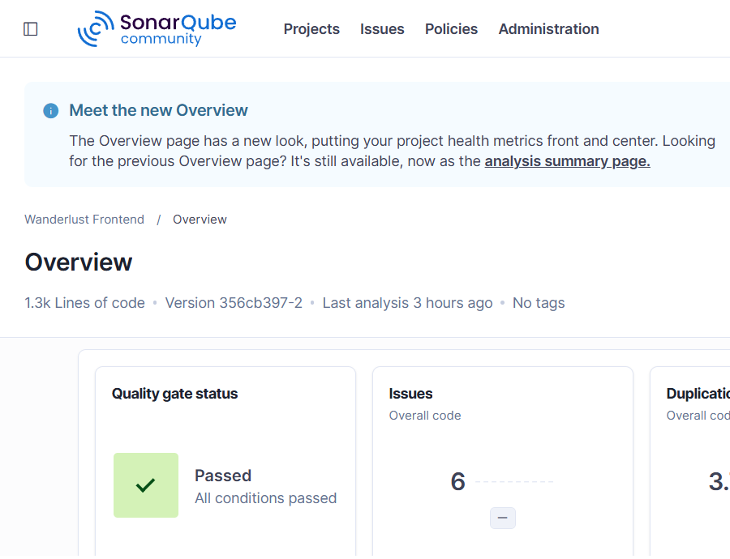

# Jenkins CI: check every change

CI means **continuous integration**. It is an automatic checklist that runs when application code
changes. Jenkins runs separate pipelines for the frontend and backend.

*The dashboard lists recent successful and failed builds. A green check means that particular
build completed successfully; an older failure remains visible as useful history.*

## What happens in each app pipeline?

The frontend and backend pipelines follow the same safety-first pattern:

1. **Check out the code** and create a version tag from the short Git commit and build number.
2. **Look for leaked secrets** with Gitleaks.
3. **Scan source and dependencies** with Trivy and OWASP Dependency-Check.
4. **Run automated tests** with Jest.
5. **Analyze code** in SonarQube and wait for its quality gate.
6. **Check container configuration** with Hadolint and Trivy config scanning.
7. **Build a Docker image** and scan the finished image with Trivy.
8. **Push the image to Amazon ECR** using the EC2 instance role.
9. **Start the GitOps delivery job** with only the changed service's image tag.

Some scan settings are configurable. Security scans can stop a build when a configured rule is
violated; a red build is a signal to inspect the failed stage rather than bypass the check.

## What does the quality gate mean?

SonarQube checks code for issues and evaluates the project's configured quality conditions. Jenkins
waits for that result. If the gate fails, the CI pipeline stops before publishing a deployable
image.

*The captured frontend overview reported “Passed.” This is a time-specific result, not a promise
that every future commit will pass.*

## Image versions

Application image tags use a short commit ID and Jenkins build number, for example
`<short-commit>-<build-number>`. This makes it possible to connect a running version back to the
source change and CI run.

The pipelines do not put credentials in the image tag. AWS access to ECR is provided through an
instance role, while other sensitive values are kept in SSM or Jenkins credentials.
