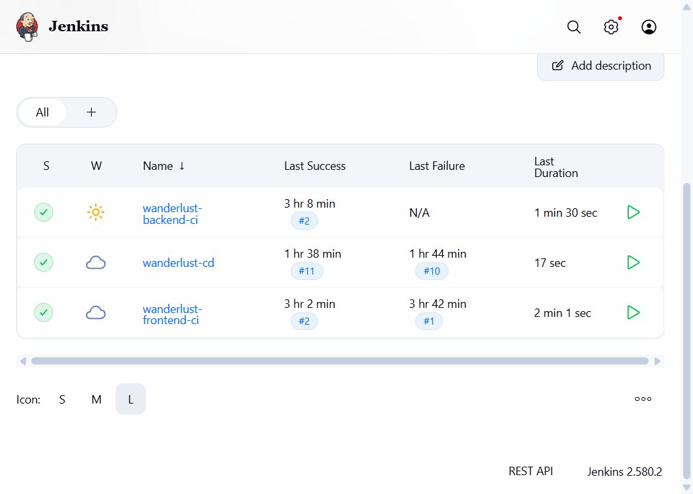
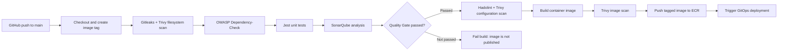
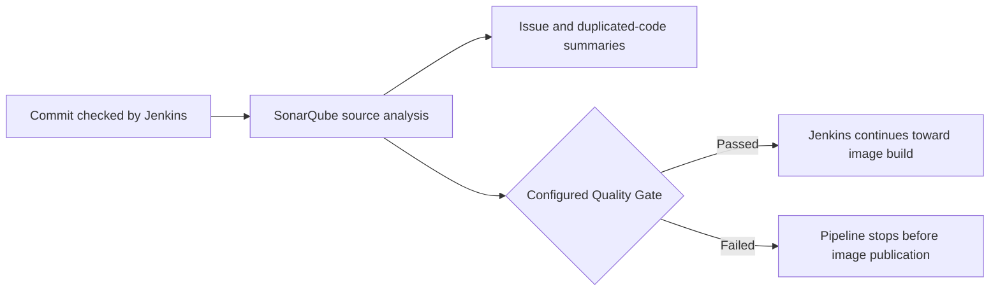

# Jenkins: how a change is checked

The frontend and backend each have a Jenkins pipeline. A pipeline is a repeatable checklist: it
runs the same tests and scans for every change, rather than relying on someone to remember each
step.

{.document-screenshot-link target=_blank rel=noopener}

*A full-screen capture scrolled to show the three job rows together. Select the image to open it at original size.*

The dashboard keeps the last successful and failed build for each job. An older failure can remain
visible after a later success; it is retained as history, not an indication that the latest build
failed. The image is a snapshot, so its build numbers and times will change.

## When the pipelines run

The Jenkins jobs follow the `main` branch. GitHub push webhooks start the frontend and backend CI
jobs. Jenkins also polls SCM every two minutes as a backup if a webhook is missed. The GitOps
delivery job is normally started by a successful application CI job with the new image tag; it
can also be run manually.

## Pipeline picture

The quality-gate check is a real stop in the normal pipeline: if it fails, Jenkins does not
publish that image. The diagram describes the main path; the scan settings below explain which
other findings block a build by default.

## What each application pipeline does

1. Checks out the source and creates a tag from the short commit ID and Jenkins build number.
2. Scans for committed secrets with Gitleaks.
3. Checks source code and dependencies with Trivy and OWASP Dependency-Check.
4. Runs the Jest test suite.
5. Sends the code to SonarQube and waits for the configured quality gate.
6. Checks container and configuration files with Hadolint and Trivy.
7. Builds the container image and scans it with Trivy.
8. Publishes the image to the private Amazon ECR registry.
9. Starts the GitOps delivery job with the new image tag.

## What fails the build?

| Check | Current default behavior |
|---|---|
| Gitleaks | A detected secret fails the build |
| Trivy filesystem scan | High/critical findings fail; unfixed vulnerabilities are ignored |
| Jest | A failed unit test fails the build |
| SonarQube Quality Gate | A failed gate stops the pipeline before image publication |
| Hadolint | Errors fail the build |
| Trivy configuration scan | Report-only by default; `TRIVY_CONFIG_EXIT_CODE=1` makes findings enforceable |
| Trivy image scan | High/critical findings fail; unfixed vulnerabilities are ignored |
| OWASP Dependency-Check | Uses CVSS `9` by default; it marks the build unstable rather than failing unless `OWASP_ENFORCE=true` |

SonarQube analysis and the quality-gate wait can be skipped only with the explicit
`SKIP_SONAR=true` setting. Avoid using that setting to get around a failing check.

## SonarQube quality gate

Jenkins waits for SonarQube's result before it publishes an image. If the quality gate fails, the
pipeline stops at that point.

{.document-screenshot-link target=_blank rel=noopener}

*This point-in-time project overview shows the quality gate as “Passed” and the reported issue count for that analysis. It is not a live dashboard or a result for future commits.*

The gate applies the project's configured conditions to the analysis. A pass records the result
for that analysis only; it is not a guarantee about a later commit.

The summary helps a reviewer understand the analysis. The quality gate applies the conditions
configured for the project; its exact thresholds are not implied by this picture.

## Tracing an image back to its source

Image tags contain an eight-character commit ID and Jenkins build number, such as
`a1b2c3d4-42`. That makes it possible to connect a deployed image to the source change and the
pipeline run that built it.

AWS access to ECR comes from the instance role. Other sensitive values are kept in SSM or Jenkins
credentials; they are not placed in image tags.

If a check fails, start with the first failed stage and its report. Fix the cause before rerunning
the smallest relevant job.
