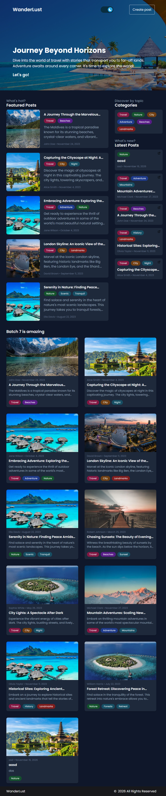

# Wanderlust

## Project overview

Wanderlust is a travel-story website running on AWS. This guide explains what is in place, how a
software change makes its way to the site, and where the main operating limits are. It is written
for project stakeholders as well as the people who build and operate the system.

**You can read and share this guide without signing in to GitHub.**

## The short version

When a developer changes the frontend or backend, Jenkins runs tests and security checks. A
successful build is stored in Amazon ECR. Jenkins records the new image version in the GitOps
repository, then Argo CD applies that version to Kubernetes. Prometheus, Grafana, and Loki help the
team see how the running system is behaving.

## What is running

| Area | What is in place |
|---|---|
| Application | A React website and an Express API, with MongoDB and Redis |
| Cloud platform | AWS VPC, load balancer, EC2 servers, container registry, and Systems Manager |
| Infrastructure setup | Terraform creates the AWS resources; Ansible configures the servers |
| Software delivery | Jenkins runs checks and builds images; Argo CD keeps Kubernetes in sync with Git |
| Monitoring | Prometheus collects metrics, Grafana displays them, and Loki stores logs |

## How a release reaches the website

1. A developer changes the application and pushes the code.
2. Jenkins checks the code, runs tests and security scans, and builds a container image.
3. Jenkins stores the image in ECR and records its version in Git.
4. Argo CD sees the Git change and updates the Kubernetes application.
5. The delivery job checks that Argo CD reports the application as **Synced** and **Healthy**.

This keeps a useful record of each release: the source change, the checks it passed, the image that
was created, and the configuration Kubernetes was asked to run.

## A look at the application

This is the complete page as it appeared during the documentation capture. Select the image to
open the original-size version.

{.document-screenshot-link target=_blank rel=noopener}

*The full landing page, including its featured stories, categories, and latest posts.*

## What the current setup does not provide

This is a working lab and project demonstration, not a highly available production service. The
Kubernetes cluster has one worker node, and the application and monitoring tools run on that same
node. If it becomes unavailable, both the website and its monitoring can be interrupted. The
monitoring setup has no external alert-notification receiver.

Those limits are deliberate and visible in the design; they should be addressed before using this
setup for a service that needs production-grade availability or incident response.

## Where to go next

- [See the AWS network and application path](architecture.md)
- [Review services and their configured versions](technology-stack.md)
- [Start the application locally](local-development.md)
- [Follow a change through Jenkins and Argo CD](ci.md)
- [Review monitoring and operational limits](monitoring.md)
- [Find checks, troubleshooting steps, and cost notes](operations.md)

Screenshots in this guide are point-in-time evidence, not live dashboards. Operator names,
credentials, AWS account and instance identifiers, and private addresses are omitted or redacted.
