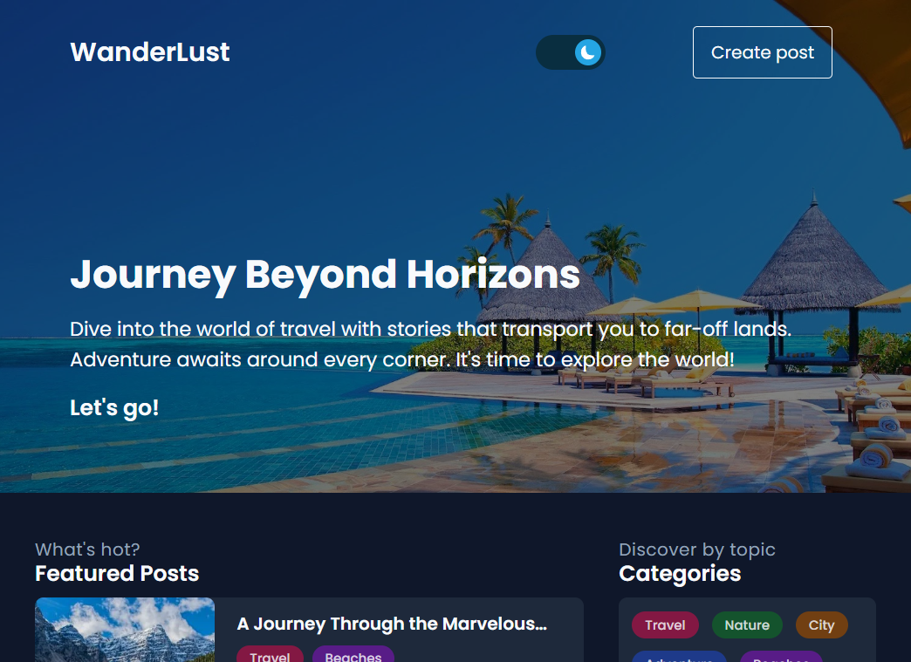

# Welcome to Wanderlust

Wanderlust is a travel-blog website. People can read travel stories, browse them by topic, and
create a post. Behind that simple page is a small delivery system that checks code, builds
containers, and keeps the running application in sync with its configuration.

This guide explains that system one small piece at a time. It is written for curious beginners:
you do not need to know AWS or Kubernetes before you start.

## The whole journey in one minute

1. A developer changes the frontend or backend code.
2. Jenkins checks the change, runs tests and security scans, and builds a container image.
3. Jenkins stores the image in Amazon ECR, the project's private image shelf.
4. A delivery job updates the image version in the GitOps repository.
5. Argo CD notices that Git change and tells Kubernetes to run the new version.
6. Prometheus measures how the cluster is doing, while Grafana displays charts and Loki stores
   application logs.

Think of it like a restaurant: the source code is the recipe, Jenkins is the kitchen's quality
check, ECR is the pantry, GitOps is the order ticket, and Kubernetes is the team that serves the
finished meal.

## What this guide covers

- The five repositories and what belongs in each one.
- The AWS network, EC2 servers, and kubeadm-based Kubernetes cluster.
- Terraform and Ansible responsibilities.
- Jenkins security checks and the CI/CD hand-off to Argo CD.
- Prometheus, Grafana, Loki, and Alloy monitoring.
- Safe local development, verification, troubleshooting, and cleanup.

> **Public-site safety:** This is a public documentation site. It intentionally does not include
> passwords, tokens, AWS account numbers, instance IDs, public IPs, or private admin URLs. The
> project source repositories remain private.

## The important distinction

The project runs Kubernetes on EC2 machines using **kubeadm**. It does **not** use Amazon EKS.
Terraform creates the network and machines; Ansible configures them; Kubernetes runs the
application and monitoring services.

## Start reading

If you are new to the project, read [the AWS and Kubernetes map](architecture.md) first. Then
follow the pages in the navigation from infrastructure, to CI, to GitOps and monitoring.

## Screenshots

These are real application and service screenshots captured during documentation work. A
screenshot shows one moment in time; build numbers, alerts, and health can change.

*The website's landing page. The live address is not included in this public guide.*
