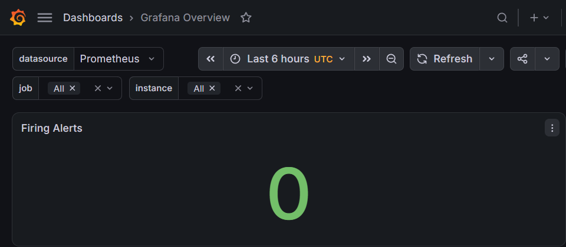

# Monitoring: see what the cluster is doing

Monitoring helps answer three questions: **Is it working? Is it getting slower? What happened
when it stopped working?**

The stack runs on the existing Kubernetes worker, so it does not add a separate monitoring EC2
instance.

| Tool | Simple explanation | Role in this project |
|---|---|---|
| Prometheus | A collector that regularly asks services for numbers | Stores metrics and evaluates alert rules |
| Grafana | A dashboard for graphs and status panels | Displays Prometheus metrics and Loki logs |
| Loki | A searchable store for text logs | Keeps pod logs for a limited retention period |
| Grafana Alloy | A small collector/forwarder | Collects pod logs and Kubernetes events for Loki |

Prometheus also scrapes ingress-nginx request metrics. Grafana uses a private ClusterIP service;
it is not exposed through the public load balancer.

*At capture time the overview showed zero firing alerts. That only describes the displayed time
range; it does not guarantee that the system will never have an alert.*

## Storage and limits

The Helm charts use the cluster's existing `local-path` storage class. Prometheus, Loki, Grafana,
and Alertmanager use small persistent volumes on the worker. Prometheus and Loki retain a limited
window of data (the project configuration uses seven-day retention).

This is a learning/lab setup, not a highly available monitoring platform:

- There is one Kubernetes worker, so its failure can interrupt the application and monitoring.
- Data is stored on that worker and is not replicated to another node.
- Alert rules are evaluated locally, but no external notification receiver is configured.

## How to explore safely

Use the approved SSM port-forwarding instructions from the private deployment guide to access
Grafana. Retrieve its password from the encrypted parameter store when needed. Do not copy the
password into Git, a shell transcript, or this public site.

In Grafana, start with the overview dashboard, then use Explore to search logs in Loki. Choose a
namespace or pod label before widening a query so results remain manageable.

## What an alert does

An alert rule is a condition such as “the service has been unavailable for several checks.” A
firing alert means the condition is currently true. An alert dashboard is useful, but a person
still needs a notification channel and a response plan for production use.
