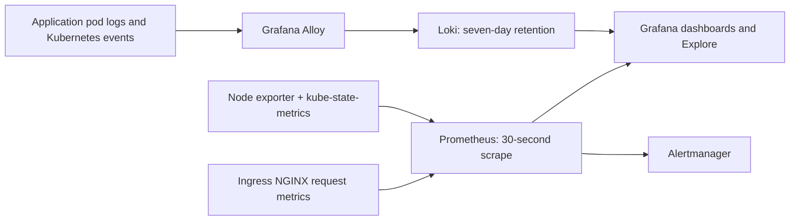
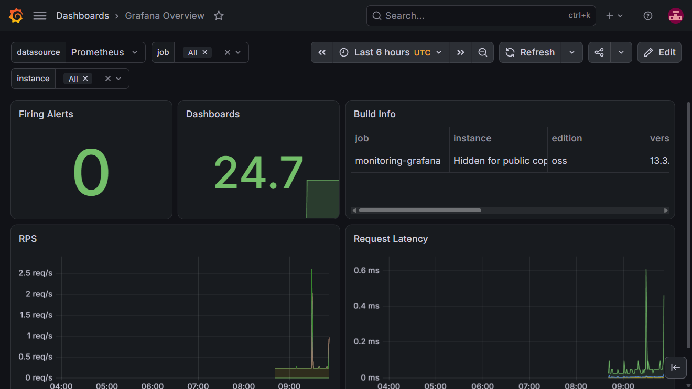
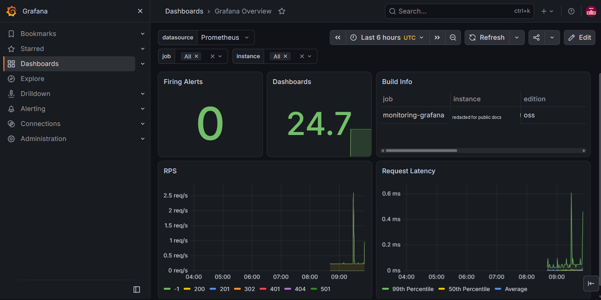
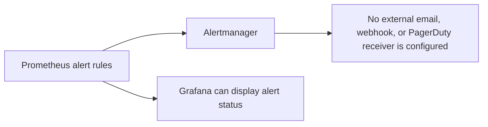

# Monitoring

The monitoring stack helps the team answer three practical questions: Is the application
responding? Is it getting slower? What do the service logs show?

| Tool | What it does here |
|---|---|
| Prometheus | Collects metrics and evaluates alert rules |
| Grafana | Shows dashboards and lets operators explore metrics and logs |
| Loki | Stores application logs for searching |
| Grafana Alloy | Collects pod logs and Kubernetes events for Loki |
| metrics-server | Supplies current CPU and memory figures for commands such as `kubectl top` |

## How metrics and logs move



The screenshot below is a point-in-time dashboard capture, not a live Grafana link.

[](assets/screenshots/grafana-overview-full.png){.document-screenshot-link target=_blank rel=noopener}

*This dashboard snapshot shows firing-alert status, request rate, and request latency for its selected time range.*

[](assets/screenshots/grafana-dashboard-full-screen.png){.document-screenshot-link target=_blank rel=noopener}

*A second full-screen capture shows the Grafana navigation and overview panels. The internal endpoint is redacted; values and time ranges are from the capture, not live data.*

## Useful signals to watch

| Question | Useful signal |
|---|---|
| Are users getting errors? | Ingress response codes, especially HTTP 5xx, and backend error logs |
| Is the site getting slower? | Ingress request latency and request rate |
| Is a container healthy? | Pod readiness, restart count, and recent application logs |
| Is a node short on resources? | CPU and memory from `kubectl top` and cluster dashboards |
| Is storage running out? | Filesystem and persistent-volume usage on the worker |

Prometheus scrapes ingress-nginx metrics every 30 seconds. The monitoring charts also include
Kubernetes and node metrics. `metrics-server` supports short-lived `kubectl top` readings; those
readings are not a replacement for retained Prometheus history.

## Alerting and limits



Alert rules are evaluated locally, but an alert visible in Grafana does not by itself notify an
on-call person. Production operations would need an external notification path, a response owner,
and a tested recovery process.

- Prometheus retains up to 168 hours or 4 GB of metrics.
- Loki retains logs for 168 hours.
- Prometheus and Loki use the cluster's local-path storage.
- The application and monitoring tools run on the same Kubernetes worker. If it becomes
  unavailable, both the website and its monitoring can be interrupted.
- Grafana is a private cluster service; it is not exposed through the public load balancer.

## Open the dashboard

An authorized operator can use SSM remote-host port forwarding from the worker to Grafana's
cluster-internal service. First, obtain the worker instance ID and Grafana service ClusterIP
through the approved AWS and Kubernetes access process. Keep those values private.

From the authorized Kubernetes context, `kubectl get svc -n monitoring` lists the service and its
ClusterIP. Use the Grafana service's ClusterIP and service port `80` in the tunnel below.

In PowerShell, replace the two example values with the current private values:

```powershell
$workerInstanceId = "<worker-instance-id>"
$grafanaServiceIp = "<grafana-service-cluster-ip>"
$parameters = @{
  host = @($grafanaServiceIp)
  portNumber = @("80")
  localPortNumber = @("13000")
} | ConvertTo-Json -Compress

aws ssm start-session `
  --target $workerInstanceId `
  --document-name AWS-StartPortForwardingSessionToRemoteHost `
  --parameters $parameters
```

Keep that session open, then visit `http://localhost:13000/` in the same computer's browser and
sign in using the credential provided through the approved secret-store process. Do not publish
the password, worker ID, ClusterIP, or a screenshot containing them. There is no public Grafana
URL.

For common dashboard and data-collection issues, see the
[troubleshooting runbook](operations.md).
